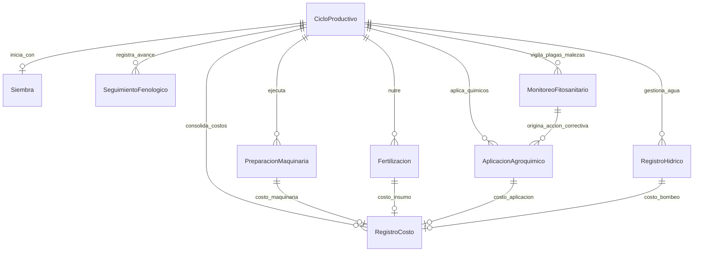

# Documento de Especificación Formal de Requisitos de Software (SRS)
## Proyecto: Sistema de Información Georreferenciada para el Cultivo de Arroz (SIG-ARROZ)
### Solicitud de Cambio: CR-001 | Plan de Gestión de Configuración de Software (IEEE 828:2022)
### Tarea: HU-021-A — Formalización de Requisitos Funcionales RF-21 a RF-33

---

## 1. Control del Documento y Trazabilidad de Configuración (IEEE 828:2022)

| Elemento de Configuración (CI) | Detalle |
| :--- | :--- |
| **Código del CI** | `DOC-SRS-SIGARROZ-CR001-RF21-33` |
| **Versión del CI** | `2.0.0` (Línea Base Documental Post-Sprint 3) |
| **Historia de Usuario** | **HU-021-A**: Especificación Formal de Requisitos RF-21 a RF-33 |
| **Solicitud de Cambio Asociada** | **CR-001** (Alineación Documental de Manejo Agronómico, Hídrico y Monitoreo) |
| **Estado del Documento** | `APROBADO PARA LÍNEA BASE` |
| **Fecha de Emisión** | `2026-11-02` |
| **Clasificación de Seguridad** | Uso Interno / Equipo de Ingeniería SIG-ARROZ |
| **Norma de Referencia** | IEEE Std 828:2022 (Configuration Management in Systems and Software Engineering) & IEEE Std 830 / ISO/IEC/IEEE 29148:2018 |

---

## 2. Alcance y Contexto Operacional

El presente documento formaliza los requisitos funcionales implementados en el núcleo de servicios Django REST Framework (`sig-arroz-backend`) y su interfaz reactiva en React / Tailwind CSS (`sig-arroz-frontend`), organizados en tres épicas críticas del ciclo agronómico del arroz:

1. **Épica EP-05: Manejo Agronómico** (RF-21 a RF-24).
2. **Épica EP-06: Manejo Hídrico y Control de Riego** (RF-25 a RF-29).
3. **Épica EP-07: Monitoreo Integral del Cultivo** (RF-30 a RF-33).

---

## 3. Matriz de Trazabilidad Bidireccional de la Línea Base

| Épica | ID RF | Nombre del Requisito Funcional | Modelo(s) ORM Backend | ViewSet / Endpoint REST | Componente Frontend / Tab UI |
| :--- | :--- | :--- | :--- | :--- | :--- |
| **EP-05** | **RF-21** | Control de Malezas | `MonitoreoFitosanitario`, `AplicacionAgroquimico`, `RegistroCosto` | `MonitoreoFitosanitarioViewSet` (`/api/monitoreos/`), `AplicacionAgroquimicoViewSet` (`/api/aplicaciones-agroquimicos/`) | `CicloDetalle.jsx` (Tabs: `fitosanitario`, `preparacion`) |
| **EP-05** | **RF-22** | Aplicaciones Fitosanitarias | `AplicacionAgroquimico`, `Fertilizacion`, `RegistroCosto` | `AplicacionAgroquimicoViewSet` (`/api/aplicaciones-agroquimicos/`), `FertilizacionViewSet` (`/api/fertilizaciones/`) | `CicloDetalle.jsx` (Tabs: `fitosanitario`, `nutricion`) |
| **EP-05** | **RF-23** | Etapas Fenológicas | `SeguimientoFenologico`, `Siembra`, `CicloProductivo` | `SeguimientoFenologicoViewSet` (`/api/fenologia/`) | `CicloDetalle.jsx` (Tab: `fenologia`) |
| **EP-05** | **RF-24** | Historial Agronómico | `CicloProductivo`, `PreparacionMaquinaria`, `Siembra`, `Fertilizacion`, `AplicacionAgroquimico` | `CicloProductivoViewSet` (`/api/ciclos/{id}/trazabilidad/`), `BaseCicloRelacionViewSet` | `CicloDetalle.jsx` (Tab: `trazabilidad`) |
| **EP-06** | **RF-25** | Riego | `RegistroHidrico`, `RegistroCosto`, `CicloProductivo` | `RegistroHidricoViewSet` (`/api/riegos/`) | `CicloDetalle.jsx` (Tab: `riego`) |
| **EP-06** | **RF-26** | Niveles de Agua | `RegistroHidrico` | `RegistroHidricoViewSet` (`/api/riegos/`) | `CicloDetalle.jsx` (Tab: `riego`) |
| **EP-06** | **RF-27** | Drenaje | `RegistroHidrico`, `PreparacionMaquinaria` | `RegistroHidricoViewSet` (`/api/riegos/`), `PreparacionMaquinariaViewSet` (`/api/preparacion/`) | `CicloDetalle.jsx` (Tabs: `riego`, `preparacion`) |
| **EP-06** | **RF-28** | Historial Hídrico | `RegistroHidrico`, `CicloProductivo` | `RegistroHidricoViewSet` (`/api/riegos/?ciclo_id={id}`), `/api/ciclos/{id}/trazabilidad/` | `CicloDetalle.jsx` (Tabs: `riego`, `trazabilidad`) |
| **EP-06** | **RF-29** | Alertas Hídricas | `RegistroHidrico`, `CicloProductivo` | `RegistroHidricoViewSet`, `/api/ciclos/{id}/trazabilidad/` | `CicloDetalle.jsx` (Alertas condicionales en UI de Riego) |
| **EP-07** | **RF-30** | Monitoreo Biológico | `MonitoreoFitosanitario` (tipo `'PLAGA'`) | `MonitoreoFitosanitarioViewSet` (`/api/monitoreos/`) | `CicloDetalle.jsx` (Tab: `fitosanitario`) |
| **EP-07** | **RF-31** | Monitoreo Fitosanitario | `MonitoreoFitosanitario` (tipo `'ENFERMEDAD'`), `AplicacionAgroquimico` | `MonitoreoFitosanitarioViewSet` (`/api/monitoreos/`) | `CicloDetalle.jsx` (Tab: `fitosanitario`) |
| **EP-07** | **RF-32** | Estado del Cultivo | `SeguimientoFenologico`, `CicloProductivo` | `SeguimientoFenologicoViewSet` (`/api/fenologia/`) | `CicloDetalle.jsx` (Tab: `fenologia`) |
| **EP-07** | **RF-33** | Historial de Monitoreo | `MonitoreoFitosanitario`, `CicloProductivo` | `MonitoreoFitosanitarioViewSet` (`/api/monitoreos/?ciclo_id={id}`), LocalStorage Offline | `CicloDetalle.jsx` (Tab: `fitosanitario`, Sincronización Offline) |

---

## 4. Fichas Técnicas Normalizadas de Especificación de Requisitos (RF-21 a RF-33)



---

### FICHA TÉCNICA: RF-21
* **Identificador:** `RF-21`
* **Título:** Control de Malezas (Detección, Umbral de Daño e Intervención Agronómica)
* **Actores:** Técnico Agrícola (Primario), Productor Arrocero (Secundario), Administrador (Auditor).
* **Precondiciones:**
  1. El usuario debe estar debidamente autenticado con token JWT activo (`Bearer <token>`).
  2. El ciclo productivo (`CicloProductivo`) debe existir y encontrarse en estado `'EJECUCION'`.
  3. El lote asociado debe pertenecer al productor autenticado o el usuario debe tener rol `'ADMIN'` o `'TECNICO'`.
* **Flujo Principal:**
  1. El Técnico realiza la inspección de campo en el lote asignado e identifica presencia de malezas (e.g., *Echinochloa colona*, *Ischaemum rugosum*, arroz rojo).
  2. En el sistema (`CicloDetalle.jsx`), selecciona la pestaña **"Fitosanitario"** y pulsa **"Nuevo Monitoreo"**.
  3. El sistema despliega el formulario modal de monitoreo.
  4. El Técnico selecciona el tipo de problema `tipo_problema = 'MALEZA'`, diligencia el nombre común, estima el porcentaje de umbral de daño observado (`umbral_danio_porcentaje`), redacta la decisión técnica (`decision_tecnica`) y captura opcionalmente las coordenadas GPS (`latitud`, `longitud`).
  5. El usuario envía la solicitud; el sistema valida los datos y registra la entidad `MonitoreoFitosanitario`.
  6. Si la decisión técnica requiere control químico inmediato, el Técnico accede a la opción **"Registrar Aplicación"**, seleccionando el monitoreo recién creado como referencia foránea (`monitoreo_id`).
  7. El Técnico ingresa la formulación del herbicida (`nombre_comercial`, `ingrediente_activo`), la dosis por hectárea, equipo de aspersión, variables ambientales y costos.
  8. El sistema persiste la `AplicacionAgroquimico` y genera atómicamente el registro contable en `RegistroCosto` bajo la categoría `'INSUMOS_AGROQUIMICOS'`.
  9. El sistema actualiza el tablero del ciclo reflejando la intervención y el costo asociado.
* **Flujos Alternos:**
  * **FA-21.1: Control Cultural o Mecánico sin Aplicación Química:** Si en el paso 4 el umbral es bajo (< 5%), el Técnico establece en la decisión técnica "Deshierbe manual o pase ligero de caballoneo". No se registra `AplicacionAgroquimico`, finalizando el flujo en el paso 5.
  * **FA-21.2: Fallo de Conectividad en Campo (Modo Offline):** Si el dispositivo móvil del Técnico carece de internet, la aplicación frontend almacena el monitoreo en `localStorage` bajo la clave `offline_monitoreos_{cicloId}` y notifica: *"Monitoreo guardado localmente (Offline)"*. Al restaurar la conexión, se habilita el botón de sincronización masiva.
  * **FA-21.3: Umbral Fuera de Rango:** Si el usuario ingresa un valor `< 0.0` o `> 100.0`, el serializador interrumpe el procesamiento respondiendo `400 Bad Request`.
* **Reglas de Negocio:**
  * **RN-21.1 (Validación de Porcentaje de Daño):** El campo `umbral_danio_porcentaje` debe ser de tipo numérico decimal en el rango estricto $[0.00, 100.00]$.
  * **RN-21.2 (Sincronización Transaccional de Costos):** Toda aplicación de herbicida asociada al control de malezas debe calcular su costo total como $\text{costo\_total} = \text{costo\_producto} + \text{costo\_mano\_obra}$ e insertarlo/actualizarlo de manera atómica (`transaction.atomic`) en `RegistroCosto`.
  * **RN-21.3 (Restricción de Propiedad):** Un Productor solo puede registrar intervenciones en ciclos asociados a fincas de su titularidad.
* **Modelos del Dominio Involucrados:**
  * `MonitoreoFitosanitario` (Tabla: `monitoreo_fitosanitario`):
    * `id` (AutoField, PK)
    * `ciclo` (ForeignKey -> `CicloProductivo`, on_delete=CASCADE, related_name='monitoreos')
    * `fecha` (DateField)
    * `tipo_problema` (CharField, choices=[('PLAGA', 'Plaga'), ('ENFERMEDAD', 'Enfermedad'), ('MALEZA', 'Maleza')])
    * `nombre_comun` (CharField, max_length=150)
    * `umbral_danio_porcentaje` (DecimalField, max_digits=5, decimal_places=2)
    * `decision_tecnica` (TextField)
    * `latitud` (DecimalField, max_digits=9, decimal_places=6, null=True, blank=True)
    * `longitud` (DecimalField, max_digits=9, decimal_places=6, null=True, blank=True)
  * `AplicacionAgroquimico` (Tabla: `aplicacion_agroquimico`):
    * `id` (AutoField, PK)
    * `ciclo` (ForeignKey -> `CicloProductivo`, on_delete=CASCADE, related_name='aplicaciones_agroquimicos')
    * `monitoreo` (ForeignKey -> `MonitoreoFitosanitario`, on_delete=SET_NULL, null=True, blank=True, related_name='aplicaciones')
    * `fecha` (DateField)
    * `nombre_comercial` (CharField, max_length=150)
    * `ingrediente_activo` (CharField, max_length=150)
    * `dosis_por_ha` (DecimalField, max_digits=7, decimal_places=2)
    * `equipo_aspersion` (CharField, max_length=100)
    * `temperatura_c` (DecimalField, max_digits=4, decimal_places=1, null=True, blank=True)
    * `velocidad_viento_kmh` (DecimalField, max_digits=4, decimal_places=1, null=True, blank=True)
    * `periodo_carencia_dias` (IntegerField)
    * `costo_producto` (DecimalField, max_digits=12, decimal_places=2, default=0.0)
    * `costo_mano_obra` (DecimalField, max_digits=12, decimal_places=2, default=0.0)
* **Validaciones:**
  * Serializer `MonitoreoFitosanitarioSerializer`: método `validate_umbral_danio_porcentaje(value)`.
  * Serializer `AplicacionAgroquimicoSerializer`: método `validate_periodo_carencia_dias(value)` ($value \ge 0$).
  * Permiso `IsProductorOrTecnicoOrAdminForLabores`: control de autorización por perfil y relación con la finca.
* **Códigos de Respuesta API:**
  * `POST /api/monitoreos/` -> `201 Created` (Exitoso), `400 Bad Request` (Datos inválidos), `401 Unauthorized` (Sin token), `403 Forbidden` (Acceso denegado a ciclo ajeno).
  * `POST /api/aplicaciones-agroquimicos/` -> `201 Created`, `400 Bad Request`, `401 Unauthorized`, `403 Forbidden`.

---

### FICHA TÉCNICA: RF-22
* **Identificador:** `RF-22`
* **Título:** Aplicaciones Fitosanitarias y Nutricionales
* **Actores:** Técnico Agrícola, Productor Arrocero, Administrador.
* **Precondiciones:**
  1. Ciclo productivo en estado `'EJECUCION'`.
  2. Usuario autenticado con permisos de escritura sobre el ciclo.
* **Flujo Principal:**
  1. El usuario selecciona la acción de registro de aplicación química o fertilización nutricional.
  2. Si es nutrición edáfica/foliar, accede a la pestaña **"Nutrición"** e ingresa: fecha, etapa fenológica (`etapa_fenologica`), tipo de fertilizante (`tipo_fertilizante`), fuente comercial (`fuente_comercial`), dosis en kg/ha (`dosis_kg_ha`), costo del producto y costo de mano de obra.
  3. Si es protección vegetal (fungicida, insecticida, bactericida), accede a **"Aplicaciones"** e ingresa los parámetros técnicos de aspersión y variables microclimáticas.
  4. El backend recibe el payload, valida que la dosis sea estrictamente positiva y que el periodo de carencia sea válido.
  5. En una transacción atómica, el sistema guarda la entidad (`Fertilizacion` o `AplicacionAgroquimico`) e invoca la lógica de integración en `RegistroCosto`.
  6. El sistema retorna la entidad creada y el balance económico del ciclo se actualiza en tiempo real.
* **Flujos Alternos:**
  * **FA-22.1: Dosis Negativa o Nula:** Si el usuario ingresa una dosis $\le 0$, el serializador rechaza con error: *"La dosis aplicada debe ser mayor a 0"*.
  * **FA-22.2: Asociación a Monitoreo Inexistente:** Si se envía un `monitoreo_id` inexistente, se responde `400 Bad Request` indicando clave foránea inválida.
* **Reglas de Negocio:**
  * **RN-22.1 (Aritmética de Costos):** Todo gasto fitosanitario y de fertilización debe clasificarse bajo la categoría contable `'INSUMOS_AGROQUIMICOS'`.
  * **RN-22.2 (Periodo de Carencia Obligatorio):** Para aplicaciones agroquímicas, el campo `periodo_carencia_dias` es de obligado diligenciamiento ($\ge 0$), garantizando el cumplimiento de buenas prácticas agrícolas (BPA).
* **Modelos del Dominio Involucrados:**
  * `Fertilizacion` (Tabla: `fertilizacion`):
    * `id` (AutoField, PK)
    * `ciclo` (ForeignKey -> `CicloProductivo`, on_delete=CASCADE, related_name='fertilizaciones')
    * `fecha` (DateField)
    * `etapa_fenologica` (CharField, max_length=50)
    * `tipo_fertilizante` (CharField, max_length=100)
    * `fuente_comercial` (CharField, max_length=100)
    * `dosis_kg_ha` (DecimalField, max_digits=7, decimal_places=2)
    * `costo_producto` (DecimalField, max_digits=12, decimal_places=2, default=0.0)
    * `costo_mano_obra` (DecimalField, max_digits=12, decimal_places=2, default=0.0)
  * `AplicacionAgroquimico` (Tabla: `aplicacion_agroquimico`).
  * `RegistroCosto` (Tabla: `registro_costo`).
* **Validaciones:**
  * `FertilizacionSerializer.validate_dosis_kg_ha(value)`: $value > 0$.
  * `AplicacionAgroquimicoSerializer.validate_periodo_carencia_dias(value)`: $value \ge 0$.
* **Códigos de Respuesta API:**
  * `POST /api/fertilizaciones/` -> `201 Created`, `400 Bad Request`, `401 Unauthorized`, `403 Forbidden`.
  * `GET /api/fertilizaciones/?ciclo_id={id}` -> `200 OK`.
  * `POST /api/aplicaciones-agroquimicos/` -> `201 Created`, `400 Bad Request`, `401 Unauthorized`, `403 Forbidden`.

---

### FICHA TÉCNICA: RF-23
* **Identificador:** `RF-23`
* **Título:** Etapas Fenológicas del Cultivo de Arroz
* **Actores:** Técnico Agrícola, Productor Arrocero, Administrador.
* **Precondiciones:**
  1. Ciclo productivo existente.
  2. Para el cálculo automático de los días transcurridos desde siembra, debe existir previamente registrada la entidad `Siembra` vinculada al ciclo.
* **Flujo Principal:**
  1. El Técnico realiza la evaluación de crecimiento en campo y abre la pestaña **"Fenología"** del ciclo.
  2. Pulsa **"Registrar Fase Fenológica"**.
  3. Selecciona la fase actual dentro del estándar agrobiológico:
     * Fase Vegetativa: `GERMINACION`, `PLANTULA`, `MACOLLAMIENTO`.
     * Fase Reproductiva: `PRIMORDIO`, `EMBUCHAMIENTO`, `FLORACION`.
     * Fase de Maduración: `GRANO_LECHOSO`, `GRANO_PASTOSO`, `MADUREZ_COSECHA`.
  4. Selecciona el vigor del cultivo (`estado_general`: `EXCELENTE`, `BUENO`, `REGULAR`, `MALO`).
  5. Agrega observaciones cualitativas y opcionalmente adjunta una fotografía del dosel foliar / espiga.
  6. Envía el formulario; el modelo ejecuta su método `save()`, detecta la fecha de siembra del ciclo y calcula automáticamente `dias_transcurridos_calculados = (fecha - siembra.fecha).days`.
  7. El registro queda persistido y se presenta en la línea de tiempo fenológica del ciclo.
* **Flujos Alternos:**
  * **FA-23.1: Ausencia de Registro de Siembra Previa:** Si el ciclo no cuenta aún con una `Siembra` registrada, el campo `dias_transcurridos_calculados` se almacena como `null` sin bloquear la creación del evento fenológico.
  * **FA-23.2: Imagen en Formato Inválido:** Si se envía un archivo no admitido como imagen en `fotografia`, el serializador retorna `400 Bad Request`.
* **Reglas de Negocio:**
  * **RN-23.1 (Cálculo de Días de Ciclo):** Los días transcurridos son de solo lectura para el usuario cliente (`read_only_fields = ('dias_transcurridos_calculados',)`) y se calculan estrictamente en el backend.
  * **RN-23.2 (Escala Oficial de Estados de Vigor):** El vigor debe adherirse a los 4 dominios predefinidos: Excelente Vigor, Buen Desarrollo, Desarrollo Regular / Atraso, Deficiente / Estrés Severo.
* **Modelos del Dominio Involucrados:**
  * `SeguimientoFenologico` (Tabla: `seguimiento_fenologico`):
    * `id` (AutoField, PK)
    * `ciclo` (ForeignKey -> `CicloProductivo`, on_delete=CASCADE, related_name='seguimientos_fenologicos')
    * `fecha` (DateField)
    * `fase` (CharField, max_length=30, choices=FASES)
    * `estado_general` (CharField, max_length=20, choices=ESTADOS, default='BUENO')
    * `dias_transcurridos_calculados` (IntegerField, null=True, blank=True)
    * `observaciones` (TextField, null=True, blank=True)
    * `fotografia` (ImageField, upload_to='fenologia/', null=True, blank=True)
  * `Siembra` (Tabla: `siembra`).
* **Validaciones:**
  * Validación de choices permitidos para `fase` y `estado_general`.
* **Códigos de Respuesta API:**
  * `POST /api/fenologia/` -> `201 Created`, `400 Bad Request`, `401 Unauthorized`, `403 Forbidden`.
  * `GET /api/fenologia/?ciclo_id={id}` -> `200 OK`.

---

### FICHA TÉCNICA: RF-24
* **Identificador:** `RF-24`
* **Título:** Historial Agronómico y Trazabilidad Consolidada
* **Actores:** Productor Arrocero, Técnico Agrícola, Administrador, Entidades Auditoras/Certificadoras (BPA).
* **Precondiciones:**
  1. Usuario autenticado con acceso concedido al ciclo productivo.
* **Flujo Principal:**
  1. El usuario navega a la sección de **"Trazabilidad"** o historial del ciclo en `CicloDetalle.jsx`.
  2. La aplicación cliente ejecuta una solicitud HTTP GET al endpoint de trazabilidad integral: `/api/ciclos/{id}/trazabilidad/`.
  3. El backend verifica la autorización del usuario sobre el ciclo (`IsAuthenticated`, `IsProductorOrAdminOnlyForCiclos`).
  4. La vista ejecuta consultas optimizadas agrupando:
     * Datos base del ciclo, lote y finca.
     * Análisis de suelos del lote histórico.
     * Labores mecánicas de preparación (`preparaciones`).
     * Datos de siembra y germinación (`siembra`).
     * Cronología de estados fenológicos (`fenologia`).
     * Registro de monitoreos fitosanitarios (`monitoreos`).
     * Aplicaciones fitosanitarias ejecutadas (`aplicaciones`).
     * Nutrición y fertilizaciones (`fertilizaciones`).
     * Riegos y balances de lámina (`riegos`).
     * Estructura consolidada de egresos contables (`costos`).
     * Cosecha y liquidación económica (si aplican).
     * Resumen financiero de rentabilidad con aritmética Decimal de alta precisión (total egresos, balance neto, costo/ha, balance/ha).
  5. El backend responde con estructura JSON `200 OK`.
  6. El frontend renderiza la bitácora completa y permite la exportación/impresión del reporte agronómico.
* **Flujos Alternos:**
  * **FA-24.1: Ciclo No Encontrado o Acceso Denegado:** Si el ID no existe se retorna `404 Not Found`; si el productor no es dueño, se retorna `403 Forbidden`.
* **Reglas de Negocio:**
  * **RN-24.1 (Consolidación de Rentabilidad):** Todos los cálculos monetarios consolidados deben resolverse utilizando el tipo `Decimal` de Python para evitar pérdida de precisión de punto flotante (conforme a mitigación INSSA-25).
  * **RN-24.2 (Inmutabilidad Histórica de Auditoría):** El historial agronómico debe preservar el orden cronológico estricto (`order_by('fecha', 'id')`).
* **Modelos del Dominio Involucrados:**
  * Todos los modelos del ciclo (`CicloProductivo`, `Finca`, `Lote`, `AnalisisSuelo`, `PreparacionMaquinaria`, `Siembra`, `SeguimientoFenologico`, `MonitoreoFitosanitario`, `AplicacionAgroquimico`, `Fertilizacion`, `RegistroHidrico`, `RegistroCosto`, `Cosecha`, `Liquidacion`).
* **Validaciones:**
  * Comprobación de integridad referencial y permisos de lectura.
* **Códigos de Respuesta API:**
  * `GET /api/ciclos/{id}/trazabilidad/` -> `200 OK`, `401 Unauthorized`, `403 Forbidden`, `404 Not Found`.

---

### FICHA TÉCNICA: RF-25
* **Identificador:** `RF-25`
* **Título:** Gestión del Riego del Cultivo
* **Actores:** Productor Arrocero, Técnico Agrícola, Administrador.
* **Precondiciones:**
  1. Ciclo productivo en estado `'EJECUCION'` en un lote con sistema de producción de riego o secano favorecido.
* **Flujo Principal:**
  1. El operador o Técnico ingresa al tab **"Riego"** en el detalle del ciclo.
  2. Pulsa **"Nuevo Registro Hídrico"**.
  3. Ingresa la fecha de la labor, el volumen de agua captada o suministrada en metros cúbicos (`volumen_agua_m3`), la fuente de agua (`fuente_hidrica`: `CANAL`, `RIO`, `POZO`), y el costo asociado al bombeo o canon de riego (`costo_bombeo`).
  4. Ingresa las variables complementarias de lámina y drenaje (RF-26 y RF-27).
  5. Envía la petición; el serializador `RegistroHidricoSerializer` valida los tipos de datos.
  6. En el modelo `RegistroHidrico.save()`, dentro de un bloque atómico `transaction.atomic()`, se almacena el registro y se dispara la creación/actualización en `RegistroCosto` con categoría `'OTROS'` por el valor de `costo_bombeo`.
  7. El sistema confirma la creación con estado `201 Created`.
* **Flujos Alternos:**
  * **FA-25.1: Costo de Bombeo Cero:** Si el agua proviene de canal de gravedad sin costo operativo directo, `costo_bombeo` se registra como `0.00`, generándose el registro hídrico sin sobrecosto en la billetera.
* **Reglas de Negocio:**
  * **RN-25.1 (Asociación Automática de Costos de Bombeo):** Cuando el costo de bombeo sea mayor a cero, debe existir un vínculo OneToOne entre `RegistroHidrico` y `RegistroCosto`.
  * **RN-25.2 (Fuentes Hídricas Autorizadas):** Únicamente se admiten las opciones de fuente: Canal de Riego (`CANAL`), Río (`RIO`) y Pozo Profundo (`POZO`).
* **Modelos del Dominio Involucrados:**
  * `RegistroHidrico` (Tabla: `registro_hidrico`):
    * `id` (AutoField, PK)
    * `ciclo` (ForeignKey -> `CicloProductivo`, on_delete=CASCADE, related_name='riegos')
    * `fecha` (DateField)
    * `volumen_agua_m3` (DecimalField, max_digits=10, decimal_places=2)
    * `fuente_hidrica` (CharField, max_length=20, choices=[('CANAL', 'Canal de Riego'), ('RIO', 'Río'), ('POZO', 'Pozo Profundo')])
    * `costo_bombeo` (DecimalField, max_digits=12, decimal_places=2, default=0.0)
    * `dias_inundacion` (IntegerField)
    * `lamina_agua_cm` (DecimalField, max_digits=5, decimal_places=2)
    * `estado_drenaje` (CharField, max_length=20, choices=[('ABIERTO', 'Abierto'), ('CERRADO', 'Cerrado')])
  * `RegistroCosto` (Tabla: `registro_costo`).
* **Validaciones:**
  * `volumen_agua_m3 >= 0`, `costo_bombeo >= 0`.
* **Códigos de Respuesta API:**
  * `POST /api/riegos/` -> `201 Created`, `400 Bad Request`, `401 Unauthorized`, `403 Forbidden`.
  * `GET /api/riegos/?ciclo_id={id}` -> `200 OK`.

---

### FICHA TÉCNICA: RF-26
* **Identificador:** `RF-26`
* **Título:** Control y Medición de Niveles de Agua (Lámina de Inundación)
* **Actores:** Técnico Agrícola, Productor Arrocero.
* **Precondiciones:**
  1. Ciclo en ejecución con registros hídricos activos.
* **Flujo Principal:**
  1. Durante la lectura de campo con miras piezométricas o reglas graduadas en las melgas, el Técnico determina la profundidad del espejo de agua en centímetros.
  2. Registra o actualiza el campo `lamina_agua_cm` y los `dias_inundacion` acumulados en el registro hídrico.
  3. El backend almacena la medida con precisión decimal.
  4. La interfaz de usuario muestra la lámina en la tabla de control hídrico estilizada como badge (`{r.lamina_agua_cm} cm`).
* **Flujos Alternos:**
  * **FA-26.1: Valor de Lámina Negativo:** Si se envía un valor $< 0$, el backend retorna `400 Bad Request`.
* **Reglas de Negocio:**
  * **RN-26.1 (Precisión de Lámina):** El campo `lamina_agua_cm` se modela con `max_digits=5, decimal_places=2`, permitiendo lecturas milimétricas (ej. 7.50 cm).
  * **RN-26.2 (Continuidad de Inundación):** `dias_inundacion` debe ser un entero no negativo que represente los días de suelo sumergido continuo.
* **Modelos del Dominio Involucrados:**
  * `RegistroHidrico` (`lamina_agua_cm`, `dias_inundacion`).
* **Validaciones:**
  * Restricción de rango no negativo en serializador.
* **Códigos de Respuesta API:**
  * `POST /api/riegos/` -> `201 Created`.
  * `PATCH /api/riegos/{id}/` -> `200 OK`.

---

### FICHA TÉCNICA: RF-27
* **Identificador:** `RF-27`
* **Título:** Control y Estado del Drenaje de Lotes
* **Actores:** Técnico Agrícola, Productor Arrocero, Operador de Maquinaria.
* **Precondiciones:**
  1. Ciclo activo en el lote.
* **Flujo Principal:**
  1. Cuando las condiciones del cultivo exigen secar la melga (ej. aplicación de herbicidas post-emergentes, aireación de raíces contra pudrición o maduración previa a corte), el usuario define la apertura del drenaje.
  2. En el registro hídrico, selecciona `estado_drenaje = 'ABIERTO'` o `'CERRADO'`.
  3. Si la evacuación requirió adecuación de zanjas con tractor/retroexcavadora, el usuario registra complementariamente una labor en `PreparacionMaquinaria` con `labor = 'ZANJEO'`.
  4. El sistema guarda el estado del drenaje y mantiene el histórico de fechas en las cuales las compuertas permanecieron abiertas o cerradas.
* **Flujos Alternos:**
  * **FA-27.1: Estado No Reconocido:** Si se envía un string diferente a `ABIERTO` o `CERRADO`, la validación de choices de Django DRF responde con `400 Bad Request`.
* **Reglas de Negocio:**
  * **RN-27.1 (Dominio Cerrado de Drenaje):** Los únicos valores admisibles para `estado_drenaje` son `'ABIERTO'` y `'CERRADO'`.
  * **RN-27.2 (Zanjeo Mecánico):** Cuando se realicen adecuaciones físicas de canales de desagüe con maquinaria, debe reportarse bajo `labor='ZANJEO'` en `preparacion_maquinaria` para alimentar los costos del ciclo.
* **Modelos del Dominio Involucrados:**
  * `RegistroHidrico` (`estado_drenaje`).
  * `PreparacionMaquinaria` (`labor='ZANJEO'`).
* **Validaciones:**
  * Choice field validation en `RegistroHidricoSerializer`.
* **Códigos de Respuesta API:**
  * `POST /api/riegos/` -> `201 Created`.
  * `PATCH /api/riegos/{id}/` -> `200 OK`.

---

### FICHA TÉCNICA: RF-28
* **Identificador:** `RF-28`
* **Título:** Historial y Balance Hídrico del Ciclo
* **Actores:** Productor Arrocero, Técnico Agrícola, Administrador.
* **Precondiciones:**
  1. Usuario autenticado con permisos sobre el lote o ciclo.
* **Flujo Principal:**
  1. El usuario ingresa a la pestaña **"Riego"** en `CicloDetalle.jsx`.
  2. El frontend ejecuta `GET /api/riegos/?ciclo_id={cicloId}`.
  3. El backend filtra mediante `BaseCicloRelacionViewSet` verificando que el ciclo pertenezca a una finca del usuario autenticado (o que el usuario sea Admin/Técnico).
  4. Los datos son ordenados descendentemente por fecha (`order_by('-fecha', '-id')`).
  5. El cliente web computa y despliega la tabla histórica: fecha, fuente de abastecimiento con su label legible, volumen de agua ($m^3$), lámina de agua ($cm$), días de inundación, estado del drenaje y costo de bombeo consolidado.
* **Flujos Alternos:**
  * **FA-28.1: Sin Registros Previos:** Si el ciclo no tiene riegos registrados, el backend retorna una lista vacía `[]` con código `200 OK`, y el frontend muestra el empty state correspondiente.
* **Reglas de Negocio:**
  * **RN-28.1 (Filtrado Multicriterio):** El endpoint debe soportar filtrado por parámetros query: `ciclo_id`, `lote_id` y `finca_id`.
* **Modelos del Dominio Involucrados:**
  * `RegistroHidrico`, `CicloProductivo`.
* **Validaciones:**
  * Control de aislamiento multi-inquilino en `get_queryset()` según el rol del usuario.
* **Códigos de Respuesta API:**
  * `GET /api/riegos/?ciclo_id={id}` -> `200 OK`, `401 Unauthorized`, `403 Forbidden`.

---

### FICHA TÉCNICA: RF-29
* **Identificador:** `RF-29`
* **Título:** Monitoreo y Reglas de Alertas Hídricas
* **Actores:** Técnico Agrícola, Productor Arrocero, Sistema Automático.
* **Precondiciones:**
  1. Ciclo en fase de desarrollo vegetativo o reproductivo con registro de láminas de agua.
* **Flujo Principal:**
  1. El sistema evalúa los registros más recientes de `RegistroHidrico` para el ciclo seleccionado.
  2. Si la lámina registrada es menor a $2.0 \text{ cm}$ en fases susceptibles (e.g. Macollamiento o Floración), el sistema activa una alerta visual de **Estrés Hídrico por Déficit**.
  3. Si la lámina supera los $15.0 \text{ cm}$, se activa la alerta de **Riesgo de Asfixia Radicular / Sobre-inundación**, recomendando la apertura inmediata de compuertas (`estado_drenaje = 'ABIERTO'`).
  4. Si el ciclo pasa a estado `'COSECHADO'` o la fase fenológica alcanza `'MADUREZ_COSECHA'` y el drenaje sigue en `'CERRADO'`, el sistema emite una alerta crítica de **Secado Pre-Cosecha Requerido** para garantizar el soporte de peso de la cosechadora combinada.
* **Flujos Alternos:**
  * **FA-29.1: Parámetros Normales:** Si la lámina se encuentra en el rango óptimo ($3.0 \text{ cm} \le \text{lámina} \le 10.0 \text{ cm}$), el sistema presenta indicador verde de estabilidad hídrica.
* **Reglas de Negocio:**
  * **RN-29.1 (Umbrales Agronómicos de Lámina):**
    * $\text{Lámina} < 2.0 \text{ cm}$: Alerta Naranja (Déficit / Riesgo de proliferación de malezas).
    * $2.0 \text{ cm} \le \text{Lámina} \le 10.0 \text{ cm}$: Rango Óptimo.
    * $\text{Lámina} > 15.0 \text{ cm}$: Alerta Roja (Exceso hídrico / Desperdicio de recurso).
* **Modelos del Dominio Involucrados:**
  * `RegistroHidrico`, `SeguimientoFenologico`, `CicloProductivo`.
* **Validaciones:**
  * Evaluación en capa de presentación y en consultas consolidadas de trazabilidad.
* **Códigos de Respuesta API:**
  * Integrado en la respuesta de `GET /api/ciclos/{id}/trazabilidad/` (`200 OK`).

---

### FICHA TÉCNICA: RF-30
* **Identificador:** `RF-30`
* **Título:** Monitoreo Biológico e Incidencia de Artrópodos / Plagas
* **Actores:** Técnico Agrícola, Productor Arrocero.
* **Precondiciones:**
  1. Ciclo productivo en ejecución.
* **Flujo Principal:**
  1. El Técnico realiza el muestreo de campo utilizando red entomológica o conteo por metro cuadrado (e.g. monitoreo de Sogata *Tagosodes orizicolus*, Gusano enrollador *Cnaphalocrocis medinalis*, Barrenador del tallo *Diatraea* spp.).
  2. En el sistema, selecciona **"Nuevo Monitoreo"**.
  3. Establece `tipo_problema = 'PLAGA'`.
  4. Escribe el nombre común y/o científico de la plaga.
  5. Ingresa el porcentaje de daño o infestación observado (`umbral_danio_porcentaje`).
  6. Redacta la decisión técnica (e.g. "Conservación de fauna benéfica/arañas; no aplicar químicos", "Aplicación de bioinsumo").
  7. El sistema guarda el monitoreo biológico georreferenciado con latitud y longitud del punto de muestreo.
* **Flujos Alternos:**
  * **FA-30.1: Ausencia de Coordenadas GPS:** Si el dispositivo no tiene GPS o el usuario rechaza la geolocalización, los campos `latitud` y `longitud` se persisten como `null` sin impedir el guardado.
* **Reglas de Negocio:**
  * **RN-30.1 (Identificación del Problema):** El campo `nombre_comun` no debe exceder 150 caracteres y es de obligatorio diligenciamiento.
  * **RN-30.2 (Rango Porcentual):** El umbral debe estar en el intervalo $[0.00, 100.00]$.
* **Modelos del Dominio Involucrados:**
  * `MonitoreoFitosanitario` (con `tipo_problema='PLAGA'`).
* **Validaciones:**
  * Validación de rango en `MonitoreoFitosanitarioSerializer`.
* **Códigos de Respuesta API:**
  * `POST /api/monitoreos/` -> `201 Created`, `400 Bad Request`.

---

### FICHA TÉCNICA: RF-31
* **Identificador:** `RF-31`
* **Título:** Monitoreo Fitosanitario de Enfermedades (Hongos, Bacterias y Virus)
* **Actores:** Técnico Agrícola, Productor Arrocero.
* **Precondiciones:**
  1. Ciclo productivo en ejecución.
* **Flujo Principal:**
  1. El Técnico evalúa síntomas foliares o de panícula en el cultivo (e.g., Pyricularia *Pyricularia oryzae*, Complejo de manchado de grano, Añublo de la vaina *Rhizoctonia solani*).
  2. Ingresa al módulo de monitoreo y selecciona `tipo_problema = 'ENFERMEDAD'`.
  3. Ingresa la severidad/incidencia porcentual observada (`umbral_danio_porcentaje`).
  4. Redacta la recomendación técnica y guarda el registro.
  5. Si el umbral supera el nivel de daño económico (> 10%), el sistema facilita la creación referenciada de una `AplicacionAgroquimico` (fungicida/bactericida) vinculada al ID de dicho monitoreo.
* **Flujos Alternos:**
  * **FA-31.1: Superación de Umbral Crítico:** El frontend destaca visualmente en rojo (`text-red-600 font-extrabold`) todo monitoreo con daño mayor o igual a 10% para alertar al productor.
* **Reglas de Negocio:**
  * **RN-31.1 (Trazabilidad Causa-Efecto):** La aplicación agroquímica posterior mantiene una clave foránea nullable `monitoreo` que permite rastrear qué diagnóstico motivó la aspersión.
* **Modelos del Dominio Involucrados:**
  * `MonitoreoFitosanitario` (con `tipo_problema='ENFERMEDAD'`).
  * `AplicacionAgroquimico` (`monitoreo_id`).
* **Validaciones:**
  * Serializer validation de `umbral_danio_porcentaje`.
* **Códigos de Respuesta API:**
  * `POST /api/monitoreos/` -> `201 Created`, `400 Bad Request`.

---

### FICHA TÉCNICA: RF-32
* **Identificador:** `RF-32`
* **Título:** Evaluación Integral del Estado del Cultivo y Registro Fotográfico
* **Actores:** Técnico Agrícola, Productor Arrocero, Administrador.
* **Precondiciones:**
  1. Ciclo en ejecución.
* **Flujo Principal:**
  1. El Técnico accede al módulo de fenología del ciclo.
  2. Registra el estado agronómico seleccionando el indicador de desarrollo (`estado_general`: `EXCELENTE`, `BUENO`, `REGULAR`, `MALO`).
  3. Carga una evidencia fotográfica representativa del lote tomada en campo (`fotografia`).
  4. El servidor Django almacena el archivo multimedia en la ruta estructurada `media/fenologia/` y asocia la URL al registro.
  5. En el frontend se renderiza la tarjeta con el badge de estado y la previsualización de la foto.
* **Flujos Alternos:**
  * **FA-32.1: Registro sin Fotografía:** La fotografía es opcional (`blank=True, null=True`). Si no se adjunta, el registro se crea normalmente sin imagen.
* **Reglas de Negocio:**
  * **RN-32.1 (Almacenamiento de Medios):** Las imágenes se gestionan mediante el sistema de archivos de medios configurado (`MEDIA_ROOT` / `MEDIA_URL`).
* **Modelos del Dominio Involucrados:**
  * `SeguimientoFenologico` (`estado_general`, `fotografia`, `observaciones`).
* **Validaciones:**
  * Validación del tipo MIME de la imagen y tamaño admisible.
* **Códigos de Respuesta API:**
  * `POST /api/fenologia/` -> `201 Created`, `400 Bad Request`.

---

### FICHA TÉCNICA: RF-33
* **Identificador:** `RF-33`
* **Título:** Historial de Monitoreo y Resiliencia Offline en Campo
* **Actores:** Técnico Agrícola, Productor Arrocero, Administrador.
* **Precondiciones:**
  1. Usuario autenticado.
* **Flujo Principal:**
  1. El usuario consulta el histórico de monitoreos de un lote o ciclo.
  2. El frontend solicita `GET /api/monitoreos/?ciclo_id={cicloId}`.
  3. El backend devuelve la lista completa de monitoreos ordenados cronológicamente por `-fecha`, `-id`.
  4. Si el Técnico se encuentra en una zona rural sin conectividad a internet:
     * El frontend conmuta automáticamente a almacenamiento en `localStorage` (`offline_monitoreos_{cicloId}`).
     * La interfaz muestra un banner indicativo: *"Modo Offline: Monitoreos pendientes por sincronizar"*.
     * Al detectar conexión a la red, el usuario pulsa **"Sincronizar"** (`syncOfflineMonitoreos`), enviando las peticiones pendientes al backend de forma secuencial.
     * Una vez sincronizados exitosamente, el caché local es liberado.
* **Flujos Alternos:**
  * **FA-33.1: Conflicto durante la Sincronización:** Si uno de los monitoreos almacenados localmente falla por validación de backend, se notifica el error específico y se preserva el ítem no sincronizado en el almacenamiento local para corrección.
* **Reglas de Negocio:**
  * **RN-33.1 (Aislamiento de Almacenamiento Local):** Las claves de `localStorage` deben estar particionadas por ciclo (`offline_monitoreos_{cicloId}`) para evitar colisiones de datos entre distintos lotes.
  * **RN-33.2 (Orden de Visualización):** El historial debe presentar primero los monitoreos más recientes.
* **Modelos del Dominio Involucrados:**
  * `MonitoreoFitosanitario`, `CicloProductivo`.
  * Frontend Cache Engine (`localStorage`).
* **Validaciones:**
  * Idénticas a las validaciones de `MonitoreoFitosanitarioSerializer`.
* **Códigos de Respuesta API:**
  * `GET /api/monitoreos/?ciclo_id={id}` -> `200 OK`.
  * `POST /api/monitoreos/` -> `201 Created`.

---

## 5. Verificación de Cumplimiento de Criterios de Aceptación (Gherkin)

```gherkin
Característica: Cumplimiento de Línea Base Documental bajo IEEE 828:2022 (CR-001)

  Escenario: Estructura normalizada de fichas técnicas
    Dado el documento de especificación formal de requisitos
    Cuando se consulte cualquiera de los requerimientos entre RF-21 y RF-33
    Entonces cada ficha técnica contiene estrictamente los 10 campos requeridos:
      | 1. Identificador | 2. Título | 3. Actores | 4. Precondiciones | 5. Flujo Principal |
      | 6. Flujos Alternos | 7. Reglas de Negocio | 8. Modelos del Dominio | 9. Validaciones | 10. Códigos de Respuesta API |

  Escenario: Coherencia con la capa de datos existente
    Dado los modelos del backend arroz/models.py y serializers.py
    Cuando se contrastan las fichas técnicas elaboradas contra el código fuente
    Entonces se evidencia exactitud nominal y estructural en:
      | Requisito | Modelo Django | Tabla Base de Datos | Campos y Claves Foráneas Reales |
      | RF-21 | MonitoreoFitosanitario | monitoreo_fitosanitario | tipo_problema='MALEZA', umbral_danio_porcentaje |
      | RF-22 | AplicacionAgroquimico, Fertilizacion | aplicacion_agroquimico, fertilizacion | periodo_carencia_dias, dosis_kg_ha, RegistroCosto |
      | RF-23 | SeguimientoFenologico | seguimiento_fenologico | fase, estado_general, dias_transcurridos_calculados |
      | RF-24 | CicloProductivo, RegistroCosto | ciclos_productivos, registro_costo | trazabilidad, resumen_financiero Decimal |
      | RF-25 | RegistroHidrico | registro_hidrico | fuente_hidrica, volumen_agua_m3, costo_bombeo |
      | RF-26 | RegistroHidrico | registro_hidrico | lamina_agua_cm, dias_inundacion |
      | RF-27 | RegistroHidrico, PreparacionMaquinaria | registro_hidrico, preparacion_maquinaria | estado_drenaje (ABIERTO/CERRADO), labor='ZANJEO' |
      | RF-28 | RegistroHidrico | registro_hidrico | BaseCicloRelacionViewSet, filter(ciclo_id) |
      | RF-29 | RegistroHidrico | registro_hidrico | Reglas de alerta: lamina < 2cm, lamina > 15cm |
      | RF-30 | MonitoreoFitosanitario | monitoreo_fitosanitario | tipo_problema='PLAGA', latitud, longitud |
      | RF-31 | MonitoreoFitosanitario | monitoreo_fitosanitario | tipo_problema='ENFERMEDAD', AplicacionAgroquimico FK |
      | RF-32 | SeguimientoFenologico | seguimiento_fenologico | estado_general (EXCELENTE, BUENO, REGULAR, MALO), fotografia |
      | RF-33 | MonitoreoFitosanitario | monitoreo_fitosanitario | offline_monitoreos_{cicloId}, sync masivo |
```

---

## 6. Firma y Aprobación de Configuración

* **Autor:** Equipo de Análisis y Desarrollo SIG-ARROZ
* **Línea Base:** Release Post-Sprint 3 / Inicio Sprint 4
* **Aprobado por:** Analista de Requisitos & Gestor de Configuración (CR-001)
* **Fecha:** 2 de Noviembre de 2026
